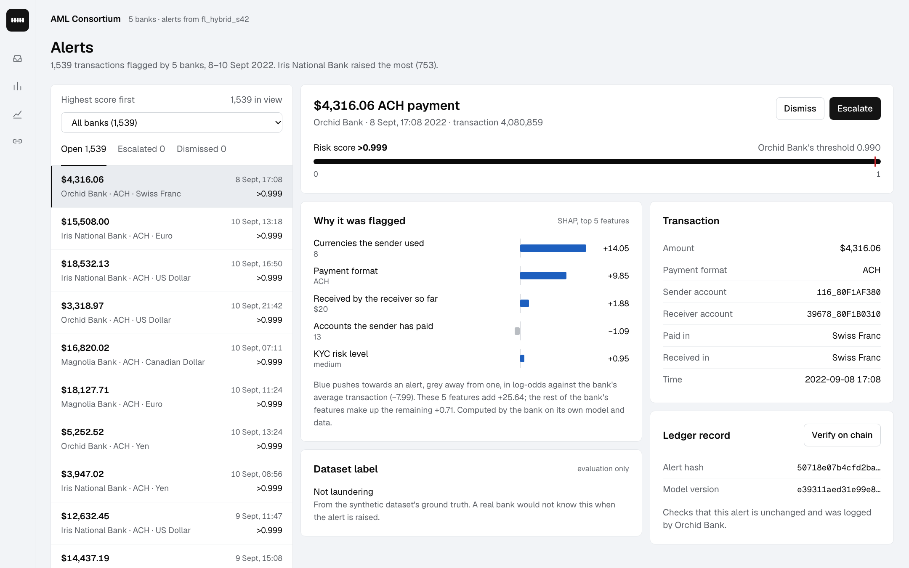
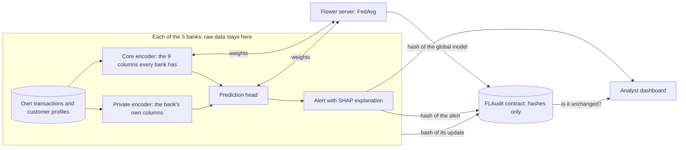
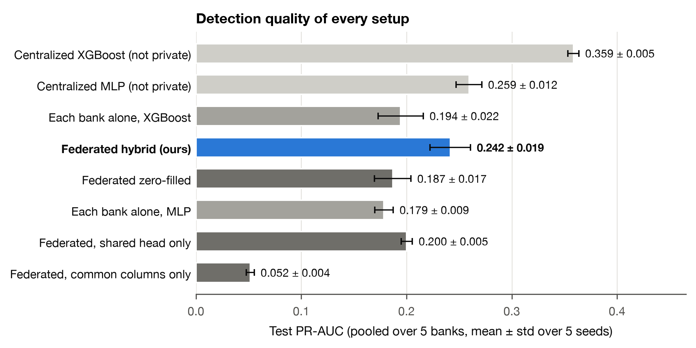

# Privacy-Preserving Money Laundering Detection


[](LICENSE)

B.E. Computer Engineering project, MES Wadia College of Engineering, Pune (2026–27).
**Team:** Anuj Nanhe, Aniket Shelke, Laiba Shaikh. **Guide:** Dr. S. R. Khonde.

Several banks train one money-laundering detection model together with **Federated Learning**
(Flower, FedAvg), and none of them shares its raw data. Each bank stores different columns:
an encoder for the columns every bank has and the prediction head are averaged across banks,
while each bank keeps a private encoder for its own columns. Alerts are explained with SHAP. A
**blockchain** audit layer (Hardhat + Solidity) records hashes of model updates and alerts, so
any later change to them can be detected.



## How it works



- **Shared:** the core encoder and the prediction head are averaged across banks every round.
- **Private:** each bank's own columns, the list of those columns and the encoder for them never
  leave the bank.
- **Audited:** only hashes go on-chain, never data or model weights. Each hash can be
  written once, so a model or alert that is changed later no longer matches its record.

**Scope.** The project detects money laundering through bank transfers between accounts.
Trade-based money laundering (invoices, goods, pricing) is future scope.

Data: [IBM Transactions for Anti Money Laundering (HI-Small)](https://www.kaggle.com/datasets/ealtman2019/ibm-transactions-for-anti-money-laundering-aml),
plus synthetic bank-specific customer profiles.

**Results** (test PR-AUC, 5 seeds; each bank sees only its own customers' payments). The hybrid
federated model reaches 0.242 ± 0.019. On every seed that is above each bank training alone
(XGBoost 0.194, MLP 0.179) and above zero-filled FedAvg (0.187). It is within 0.018 of training
the same model on all banks' pooled data (0.259), a gap that is not significant over 5 seeds.
Details: [`scaffold/src/aml_fl/fl/README.md`](scaffold/src/aml_fl/fl/README.md#results-hi-small-100-rounds-seeds-42-46).

| Setup | Test PR-AUC | Data stays at the banks |
|---|---|---|
| Centralized XGBoost | 0.359 ± 0.005 | no (pooled data) |
| Centralized MLP | 0.259 ± 0.012 | no (pooled data) |
| **Federated hybrid (ours)** | **0.242 ± 0.019** | yes |
| Federated, shared head only | 0.200 ± 0.005 | yes |
| Each bank alone, XGBoost | 0.194 ± 0.022 | yes |
| Federated zero-filled | 0.187 ± 0.017 | yes, but banks reveal their column lists |
| Each bank alone, MLP | 0.179 ± 0.009 | yes |
| Federated, common columns only | 0.052 ± 0.004 | yes |

Mean ± standard deviation over 5 seeds, pooled over the 5 banks, from
[`seeds_summary.csv`](scaffold/experiments/results/seeds_summary.csv). Centralized XGBoost on
pooled data scores highest. It shows what pooling everything would give, which the banks cannot
do without sharing their raw data.



## Quick start

```bash
cd scaffold
python3.12 -m venv ~/.venvs/aml-fl && source ~/.venvs/aml-fl/bin/activate   # outside paths with spaces
pip install torch --index-url https://download.pytorch.org/whl/cpu
pip install -r requirements.txt
pytest -q
python dashboard/app.py          # http://127.0.0.1:8000
```

**What comes with a clone.** The code, the report figures (`scaffold/docs/figures/`) and the
small results of every experiment (`scaffold/experiments/results/`: summaries, training
histories, audit hashes, alerts), so the dashboard and `make_figures.py` work straight away.
The dataset does not: to rerun experiments, download it from Kaggle (see
[`scaffold/README.md`](scaffold/README.md#get-the-data)), then
`bash scripts/run_experiments.sh` in `scaffold/` reruns every experiment in about 40 minutes.

Setup, the pipeline and the project status are in [`scaffold/README.md`](scaffold/README.md).
The full plan is in [`scaffold/docs/AML_FL_Implementation_Plan.pdf`](scaffold/docs/AML_FL_Implementation_Plan.pdf).

## What is in this repository

| Path | What |
|---|---|
| [`scaffold/`](scaffold/) | All the code: data pipeline, baselines, federated learning, audit contract, dashboard, tests and results |
| [`scaffold/src/aml_fl/fl/`](scaffold/src/aml_fl/fl/README.md) | The four federated setups, full results and known limitations |
| [`scaffold/src/aml_fl/chain/`](scaffold/src/aml_fl/chain/README.md) | The `FLAudit` Solidity contract and its Python client |
| [`scaffold/dashboard/`](scaffold/dashboard/README.md) | The analyst dashboard (FastAPI and a static front end) |
| [`scaffold/docs/figures/`](scaffold/docs/figures/) | The report figures, redrawn by `scripts/make_figures.py` |
| [`review paper/`](review%20paper/TBML_Systematic_Review.pdf) | Our systematic review of graph learning, federated learning and blockchain auditing for trade-based money laundering detection (PDF and LaTeX source) |

## License

[MIT](LICENSE)
